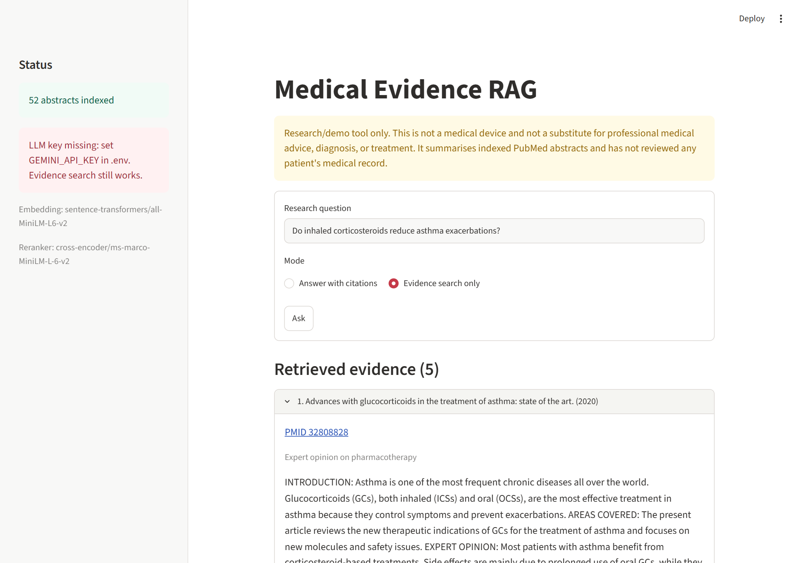
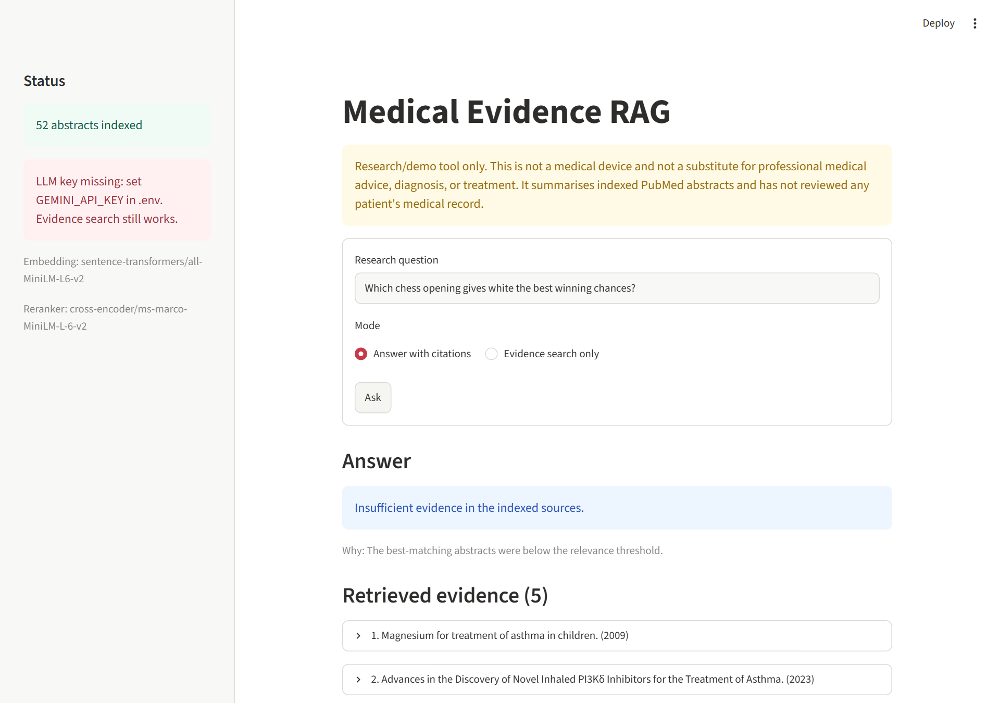
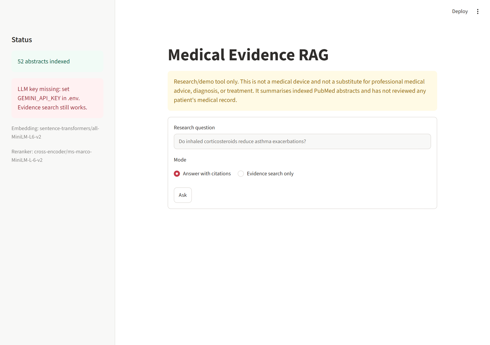
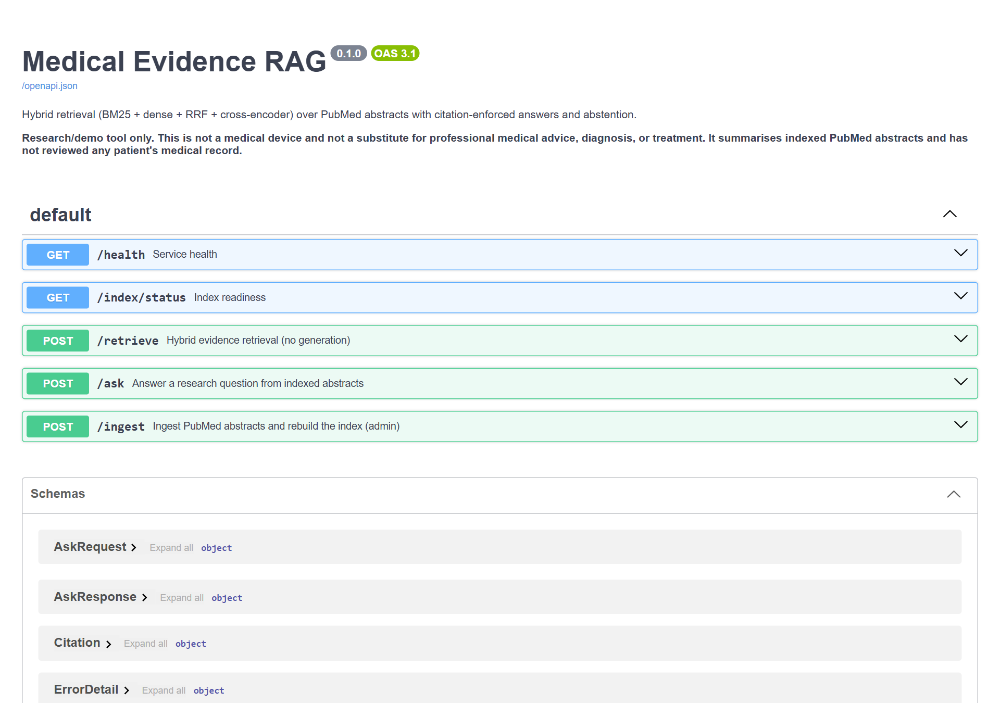
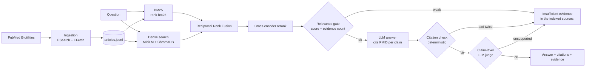

# Medical Evidence RAG with Hallucination Evaluation

Question answering over PubMed abstracts that retrieves evidence with hybrid search, answers
only from that evidence with PMID citations, and abstains when the evidence is weak. It ships
with an evaluation harness that measures retrieval quality, grounding and abstention behaviour.

> **Research/demo tool only.** This is not a medical device and not a substitute for
> professional medical advice, diagnosis, or treatment. It summarises indexed PubMed abstracts
> and has not reviewed any patient's medical record. It is not clinically validated, not
> production-ready, and it does not guarantee the absence of hallucinations.

## Contents

- [Screenshots](#screenshots)
- [Architecture](#architecture)
- [Features](#features)
- [Project structure](#project-structure)
- [Setup](#setup-windows-powershell)
- [Configuration](#configuration)
- [Ingest PubMed abstracts](#ingest-pubmed-abstracts)
- [Run the API and UI](#run-the-api-and-ui)
- [Evaluation](#evaluation)
- [Tests and quality checks](#tests-and-quality-checks)
- [What has been verified](#what-has-been-verified)
- [Known limitations](#known-limitations-and-future-improvements)

## Screenshots

All screenshots are from a real local run against 52 ingested asthma abstracts, without an LLM
key configured (so they show evidence search and abstention, not a generated answer).

**Evidence search.** Each result links to PubMed and shows its reranker, RRF, BM25 and dense
scores.



**Abstention.** An off-topic question returns the standard phrase and a short reason instead of
an answer.



**Home screen and API docs.** The sidebar reports index and LLM status; the API is documented at
`/docs`.

| Streamlit home | FastAPI docs |
| --- | --- |
|  |  |

## Architecture



| Layer | Location | Notes |
| --- | --- | --- |
| Ingestion | `app/ingestion/` | PubMed client (pacing, retries), defensive XML parser, idempotent JSONL store |
| Retrieval | `app/retrieval/` | Chunking, Chroma dense index, BM25 artifact, RRF, cross-encoder, orchestration |
| Generation | `app/generation/` | OpenAI-compatible provider, prompts, citation validation, abstention logic |
| Evaluation | `app/evaluation/` | PubMedQA loader, deterministic metrics, LLM judge, RAGAS adapter, runner |
| API / UI | `app/main.py`, `app/api/`, `app/ui.py` | FastAPI backend; Streamlit is a thin HTTP client |

## Features

- **Hybrid retrieval**: BM25 and dense (cosine) results are fused with RRF
  (`sum 1/(k + rank)`, 1-based ranks) and reranked by a cross-encoder. Every result keeps its
  PMID, PubMed URL, BM25 rank/score, dense rank/distance, RRF score and reranker score.
- **Grounded answers**: the model sees only abstracts that pass the relevance threshold, inside
  a delimited block that it is told to treat as untrusted data.
- **Citation enforcement**: PMIDs are parsed from the answer and checked against the retrieved
  set. Unknown PMIDs trigger one correction retry; if they persist, the system abstains.
- **Abstention**: returns exactly `Insufficient evidence in the indexed sources.` with a
  structured reason (`no_evidence`, `low_relevance`, `insufficient_evidence_count`,
  `model_reported_insufficient_evidence`, `invalid_citations`, `no_valid_citations`,
  `claim_check_failed`, `unsupported_claims`, `uncited_claims`). Thresholds are never relaxed
  automatically.
- **Works without an LLM key**: retrieval, index status and the relevance gate still work;
  `/ask` returns a clear `503 llm_not_configured` error when generation is actually needed.

### Safety limitations

- The reranker score is a raw cross-encoder logit. It is **not** a probability or a confidence
  level. `MIN_RERANK_SCORE` is a heuristic that must be calibrated on the validation split.
- The claim checker is an LLM. It is imperfect and is not ground truth; it can pass an
  unsupported claim or reject a supported one.
- Only abstracts are indexed (no full text), and only the ones you ingest.
- The system never gives patient-specific advice, but it cannot stop a user from misusing a
  summary. Do not use it for clinical decisions.

## Project structure

```text
.
├── app/
│   ├── main.py              # FastAPI app factory, request IDs, error handlers
│   ├── ui.py                # Streamlit UI (HTTP client only)
│   ├── api/routes.py        # /health, /index/status, /retrieve, /ask, /ingest
│   ├── core/                # config.py, logging.py, exceptions.py
│   ├── ingestion/           # pubmed.py (client), parser.py (XML), pipeline.py
│   ├── retrieval/           # chunking, dense, lexical, fusion, reranker, service
│   ├── generation/          # providers, prompts, citations, answer
│   ├── evaluation/          # dataset, deterministic, judge, ragas_adapter, runner
│   └── schemas/api.py       # request/response models
├── scripts/
│   ├── ingest_pubmed.py
│   ├── rebuild_index.py
│   ├── download_pubmedqa.py
│   └── run_evaluation.py
├── tests/                   # offline tests + fixtures
├── data/
│   ├── raw/                 # raw EFetch XML (git-ignored)
│   ├── processed/           # articles.jsonl (git-ignored)
│   ├── chroma/              # vector store + BM25 artifact (git-ignored)
│   └── eval/                # stress set (tracked); PubMedQA and reports (git-ignored)
├── docs/images/             # README screenshots
├── .env.example
└── pyproject.toml
```

## Stack and prerequisites

Python 3.11, FastAPI + Uvicorn, Streamlit, Pydantic Settings, ChromaDB, sentence-transformers,
rank-bm25, PyTorch (CPU), httpx, RAGAS, pytest, Ruff. No GPU is needed.

Versions resolved and tested on Windows 11, Python 3.11.16:

| Package | Version | Package | Version |
| --- | --- | --- | --- |
| fastapi | 0.162.4 | chromadb | 1.5.9 |
| uvicorn | 0.54.0 | sentence-transformers | 5.7.0 |
| streamlit | 1.67.0 | transformers | 4.57.6 |
| pydantic | 2.14.3 | torch | 2.15.0 |
| pydantic-settings | 2.16.2 | rank-bm25 | 0.2.2 |
| httpx | 0.28.1 | ragas | 0.4.3 |
| openai | 3.3.0 | langchain-community | 0.3.31 |
| pytest | 9.2.0 | ruff | 0.17.4 |

`langchain-community` is pinned below 0.4 because ragas 0.4.3 imports a module that 0.4 removed.

## Setup (Windows PowerShell)

```powershell
py -3.11 -m venv .venv
.\.venv\Scripts\Activate.ps1
python -m pip install --upgrade pip
pip install -e ".[dev]"
copy .env.example .env
```

If `py -3.11` reports that no runtime is found, install Python 3.11 first, or let
[uv](https://docs.astral.sh/uv/) fetch it: `uv venv --seed --python 3.11 .venv`.

macOS/Linux:

```bash
python3.11 -m venv .venv
source .venv/bin/activate
python -m pip install --upgrade pip
pip install -e ".[dev]"
cp .env.example .env
```

## Configuration

All settings are environment variables, read from `.env` (never commit it). Invalid values stop
the app at startup with a message naming the variable.

| Variable | Default | Purpose |
| --- | --- | --- |
| `GEMINI_API_KEY` | empty | Google Gemini key (default provider). Empty disables generation only. |
| `OPENAI_API_KEY` | empty | Alternative OpenAI-compatible key. Ignored when `GEMINI_API_KEY` is set. |
| `LLM_BASE_URL` | provider default | Any server exposing `/chat/completions`. Gemini: `https://generativelanguage.googleapis.com/v1beta/openai`; OpenAI: `https://api.openai.com/v1`. |
| `LLM_MODEL` | `gemini-2.5-flash` (Gemini) / `gpt-4o-mini` (OpenAI) | Not validated. Set it to a model your key can use. |
| `EMBEDDING_MODEL` | `sentence-transformers/all-MiniLM-L6-v2` | Dense embedding model. |
| `RERANKER_MODEL` | `cross-encoder/ms-marco-MiniLM-L-6-v2` | Cross-encoder. |
| `CHROMA_PATH`, `CHROMA_COLLECTION` | `data/chroma`, `pubmed_abstracts` | Vector store location. |
| `PUBMED_EMAIL`, `PUBMED_API_KEY` | empty | Sent to NCBI. Email is recommended; the key raises the rate limit. |
| `TOP_K_BM25`, `TOP_K_DENSE`, `TOP_K_FUSION`, `TOP_K_RERANK` | 20, 20, 15, 5 | Candidates kept at each stage. |
| `RRF_K` | 60 | RRF constant. |
| `MIN_RERANK_SCORE` | 0.0 | Raw-logit threshold for a "sufficiently relevant" abstract. |
| `MIN_EVIDENCE_COUNT` | 2 | Relevant abstracts required before generating. |
| `ENABLE_CLAIM_CHECK` | true | Run the claim-level judge on every draft (one extra LLM call). |
| `MIN_CLAIM_SUPPORT_RATE`, `MIN_CITATION_COVERAGE` | 0.8, 0.8 | Judge thresholds below which the answer is withheld. |
| `MAX_ABSTRACT_CHARS` | 4000 | Abstracts longer than this are split on sentence boundaries. |
| `REQUEST_TIMEOUT_SECONDS` | 30 | Timeout for PubMed and LLM calls. |
| `ADMIN_TOKEN` | empty | Enables `POST /ingest` when set (sent as `X-Admin-Token`). |

Put your API key in `.env` only. Gemini is called through Google's OpenAI-compatible endpoint,
so the same provider code (`app/generation/providers.py`) serves Gemini, OpenAI and local
servers. The `seed` parameter is not sent to Gemini. To use a local OpenAI-compatible server,
set `LLM_BASE_URL` and `LLM_MODEL`, and put any non-empty placeholder in `OPENAI_API_KEY`.

## Ingest PubMed abstracts

```powershell
python scripts/ingest_pubmed.py --query "asthma treatment" --max-records 50
python scripts/ingest_pubmed.py --query "asthma biologics" --max-records 100 --min-date 2018 --max-date 2024
```

This runs ESearch then EFetch, skips records without an abstract (and reports how many), merges
new articles into `data/processed/articles.jsonl` keyed by PMID, saves the raw XML under
`data/raw/`, and updates both indexes. Re-running a query fetches nothing that is already
stored and creates no duplicates. Add `--no-index` to update only the JSONL file.

## Rebuild the index

```powershell
python scripts/rebuild_index.py
python scripts/rebuild_index.py --input tests/fixtures/sample_articles.jsonl
```

Rebuilding makes the index match the input file exactly: chunks are upserted by stable ID
(`PMID_<pmid>_<chunk_number>`) and chunks that are no longer in the file are removed. The BM25
artifact (`data/chroma/bm25_<collection>.json`) is versioned and is rebuilt from Chroma
automatically if it is missing or incompatible.

## Run the API and UI

```powershell
uvicorn app.main:app --reload
# in a second terminal (with the venv activated)
streamlit run app/ui.py
```

API docs are at <http://127.0.0.1:8000/docs>; the UI is at <http://localhost:8501>. The UI reads
the backend address from `API_BASE_URL` (default `http://127.0.0.1:8000`).

| Endpoint | Purpose |
| --- | --- |
| `GET /health` | Liveness and non-secret configuration |
| `GET /index/status` | Chunk counts and readiness |
| `POST /retrieve` | Hybrid retrieval only |
| `POST /ask` | Retrieval, answer, citations, abstention status |
| `POST /ingest` | Ingest and reindex; disabled unless `ADMIN_TOKEN` is set |

Errors use one shape, `{"error": {"code", "message"}, "request_id"}`: 409 `index_empty`,
422 `validation_error`, 502 `llm_provider_error` / `pubmed_error`, 503 `llm_not_configured`.
Every response carries an `X-Request-ID` header.

### Sample request and response

```powershell
Invoke-RestMethod -Method Post -Uri http://127.0.0.1:8000/ask `
  -ContentType "application/json" `
  -Body '{"question": "Which chess opening gives white the best winning chances?"}'
```

Response recorded from a real run against the 50-abstract asthma index (evidence list
shortened to one item):

```json
{
  "answer": "Insufficient evidence in the indexed sources.",
  "abstained": true,
  "abstention_reason": "low_relevance",
  "abstention_message": "The best-matching abstracts were below the relevance threshold.",
  "citations": [],
  "evidence": [
    {
      "chunk_id": "PMID_19752254_0",
      "pmid": "19752254",
      "pubmed_url": "https://pubmed.ncbi.nlm.nih.gov/19752254/",
      "title": "Magnesium for treatment of asthma in children.",
      "publication_year": 2009,
      "...": "bm25_rank, bm25_score, dense_rank, dense_distance, rrf_score, rerank_score, final_rank"
    }
  ],
  "disclaimer": "Research/demo tool only. ...",
  "request_id": "..."
}
```

A non-abstaining response has `abstained: false`, an `answer` whose factual sentences end in
`[PMID: ...]`, and a `citations` list of `{pmid, title, url}`. No such response is reproduced
here because none has been recorded against a real LLM yet (see "What has been verified").

## Evaluation

### Dataset

- **PubMedQA PQA-L** (1,000 expert-labelled questions), downloaded from the official repository
  <https://github.com/pubmedqa/pubmedqa> (MIT licence; cite Jin et al., EMNLP 2019 when
  publishing). The download writes `data/eval/pubmedqa/manifest.json` with source URLs, SHA-256
  digests and the download time; that manifest is saved in every report as the dataset version.
- **Splits**: `test` is the official 500-question test set. The other 500 are shuffled with
  `SEED`: 100 form `dev` (smoke tests) and 400 form `validation` (threshold tuning). Do not tune
  thresholds on `test`.
- **Unanswerable stress set**: `data/eval/unanswerable_stress.jsonl` holds 12 hand-written
  questions (off-topic, or about invented drugs and diseases). They are synthetic, labelled
  `synthetic_unanswerable`, and reported separately. They are not expert ground truth.
- PubMedQA questions are treated as answerable from their own abstract, including those
  labelled `maybe`. The yes/no/maybe label itself is not scored.

### Running

```powershell
python scripts/download_pubmedqa.py
python scripts/run_evaluation.py --split dev --limit 20
python scripts/run_evaluation.py --split test
```

Two context modes keep dataset context and corpus context apart:

- `--context-mode dataset` (default) indexes PubMedQA's own abstracts into a separate Chroma
  collection under `data/eval/chroma`, together with `--distractors` extra abstracts from the
  same split (default 80). The gold PMID is known, so retrieval metrics can be computed. Each
  question has one gold abstract, so this mode sets `MIN_EVIDENCE_COUNT=1` (recorded in the
  report; override with `--min-evidence-count`).
- `--context-mode corpus` queries your ingested PubMed index. Retrieval metrics are computed
  only for questions whose gold PMID happens to be indexed, and are otherwise `not_computed`.

Each run writes `results.jsonl`, `summary.json` and `summary.csv` to
`data/eval/runs/<timestamp>_<split>/`, including model names, package versions, thresholds,
dataset manifest and run options. Other flags: `--no-stress`, `--no-ragas`, `--output-dir`.

### Metrics, and what they do and do not show

| Metric | Definition | Caveat |
| --- | --- | --- |
| Recall@k, MRR, nDCG@k | Rank of the gold PMID among the top `TOP_K_RERANK` results | One gold document per question. PubMedQA questions are derived from article titles, so this is easier than real user questions. |
| Citation validity rate | Cited PMIDs that were retrieved / cited PMIDs, over final drafts | Includes drafts later rejected. Delivered answers are 1.0 by construction. |
| Claim support rate | Supported claims / checkable claims (LLM judge) | Delivered answers already passed the same judge, so this is biased upward. `draft_*` versions include rejected drafts. |
| Citation coverage | Checkable claims with a valid citation / checkable claims | Depends on how the judge splits claims. |
| Refusal correctness | Abstentions / unanswerable questions | Measured on the synthetic stress set. |
| False abstention rate | Abstentions / answerable questions | Counts PubMedQA `maybe` questions as answerable. |
| Unsafe answer rate | Answers / unanswerable questions | Same stress-set caveat. |
| Abstention precision, recall, F1 | Positive class = abstain | Not computed unless every row has an outcome. |
| RAGAS faithfulness, context precision, context recall | ragas 0.4 `metrics.collections` | LLM-based. Context recall needs a reference (PubMedQA's long answer). |

A metric that could not be measured is saved as `"status": "not_computed"` with a reason. It
is never written as zero. Without an LLM key, retrieval metrics and the stress-set relevance
gate are still measured; everything that needs generation is `not_computed`.

### Measured so far

One smoke run has been executed: `--split dev --limit 20`, **without an LLM key**, on CPU.

| Metric | Value | n |
| --- | --- | --- |
| Recall@5 | 1.000 | 20 |
| MRR | 1.000 | 20 |
| nDCG@5 | 1.000 | 20 |
| Stress-set refusal correctness (relevance gate only) | 1.000 | 12 |

This is a 20-question smoke test against a 100-abstract index, not a benchmark result. No
faithfulness, claim-support, citation or full abstention numbers exist yet, because they need
an LLM. The `validation` and `test` splits have not been run.

### Calibrating the abstention threshold

`MIN_RERANK_SCORE=0.0` is an uncalibrated starting point. To tune it, run
`python scripts/run_evaluation.py --split validation` at several values, compare false
abstention rate against unsafe answer rate, pick a value, and only then run `--split test` once.

## Tests and quality checks

```powershell
pytest -q
ruff check .
ruff format --check .
```

The tests need no network, API key or model download: PubMed and the LLM are mocked at the
HTTP layer, and the embedding model and cross-encoder are replaced by deterministic fakes
(ChromaDB itself runs for real in a temporary directory). One test imports ragas to check the
adapter against the installed API, which takes about 20 seconds.

## What has been verified

Run on Windows 11, Python 3.11.16, CPU only:

- `pytest -q`: 142 passed. `ruff check .` and `ruff format --check .`: clean.
- Real PubMed ingestion of 50 abstracts. A second run of the same query skipped the 48 PMIDs
  already stored and added 2 that PubMed's relevance ranking had newly returned, leaving 52
  articles with no duplicates.
- Index rebuild from `tests/fixtures/sample_articles.jsonl`.
- Real hybrid retrieval with both Hugging Face models.
- The API served by Uvicorn: `/health`, `/index/status`, `/retrieve`, `/ask` (abstention, the
  503 without a key, and a 422).
- The Streamlit UI against the live API: status sidebar, evidence cards with PMID links and
  scores, the abstention message, and the missing-key error.
- PubMedQA download and the smoke evaluation above.

**Not verified:** answer generation, the claim judge and RAGAS against a real LLM. No API key
was available, so these paths are covered only by tests with a scripted fake LLM and mocked
HTTP. Expect to adjust prompts or thresholds once a real model is connected.

## CPU performance notes

- First use downloads the embedding model (about 90 MB) and the cross-encoder (about 90 MB)
  from Hugging Face into its default cache. Nothing is downloaded at import or API startup;
  models load on the first query or indexing call.
- On the development laptop, indexing 100 abstracts took about 15 seconds after model load,
  and a query (retrieval plus reranking 15 candidates) took 1 to 2 seconds. Importing
  PyTorch and loading a model can add 10 to 60 seconds to the first call in a new process.
- `/ask` adds two LLM calls (answer and claim check), or three if a citation retry is needed.

## Known limitations and future improvements

- No real-LLM evaluation has been run yet; all thresholds are uncalibrated defaults.
- BM25 is rebuilt in memory from a JSON artifact, which suits thousands of abstracts, not
  millions.
- The tokenizer is a simple alphanumeric splitter with no stemming or biomedical synonyms.
- Conflicting sources are handled by the prompt and the judge, not by a dedicated detector.
- PubMedQA yes/no/maybe accuracy is not scored.
- `POST /ingest` runs synchronously and is meant for small local batches.
- Possible next steps: a biomedical embedding model, MeSH query expansion, full-text sources,
  a separate judge model, and threshold calibration curves in the report.
